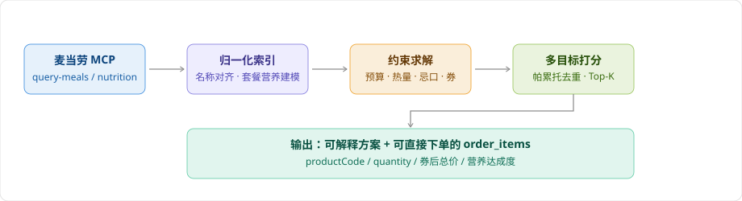

<div align="center">

# 麦麦点餐参谋

**🍟 用约束求解器算出一顿饭，而不是让大模型随口推荐。**

基于麦当劳中国 MCP 的 WorkBuddy Skill —— 输入预算、人数、热量/蛋白目标与忌口，
输出多套**可解释、券后算清、可直接下单**的套餐方案。


</div>

---

## 它和「让大模型推荐套餐」有什么不同？

市面上同类项目大多是"把菜单丢给大模型，让它编一套搭配"。这有三个硬伤：
**编出来的商品编码是假的、价格是猜的、营养是按印象说的。**

麦麦点餐参谋把这一步换成了**显式约束求解**：

| | 常见做法 | 本项目 |
|---|---|---|
| 商品来源 | 模型凭印象生成 | `query-meals` 真实返回，编码可直接下单 |
| 价格 | 估价 | 门店实时价 + 券规则计算，下单前再用 `calculate-price` 复核 |
| 营养 | 凭印象 | 营养库实测值；套餐用显式建模，**并标注置信度** |
| 选品逻辑 | 模型主观偏好 | 预算/热量/蛋白/忌口作为**硬约束**，不满足直接淘汰 |
| 输出 | 一段话 | Top-K 方案 + 营养达成度 + `order_items` 直传下单 |

**一句话**：模型负责理解你的需求，数学负责算方案。

## 工作原理



## 快速开始

```bash
git clone <this-repo> && cd mcd-value
python scripts/build_index.py            # 从内置真实快照生成索引，无需 Token

# 均衡：预算 45 元，一个人
python scripts/adviser.py --budget 45 --people 1 --mode balanced

# 最省：预算 30 元，避开牛肉
python scripts/adviser.py --budget 30 --people 1 --mode value --no-beef

# 高蛋白：60 元预算，不要辣（健身场景）
python scripts/adviser.py --budget 60 --people 1 --mode protein --no-spicy

# 轻负担：热量压到 600 kcal 以内
python scripts/adviser.py --budget 40 --people 1 --mode light --max-kcal 600

# 机器可读输出（供 Agent / 脚本消费）
python scripts/adviser.py --budget 40 --people 1 --json
```

> 无需 MCP Token 即可跑通：仓库内置了 2026-10-14 抓取自
> 「麦当劳深圳同方信息港餐厅（1420762）」的**真实菜单与营养快照**（已脱敏，不含任何个人数据）。
> 要换成你附近的门店，见下方「接入你自己的门店」。

## 实际输出

```
🍟 麦麦点餐参谋 · 1420762 麦当劳深圳同方信息港餐厅
   预算 ¥45 / 1 人 · 模式 balanced
──────────────────────────────────────────────
方案 1　¥45.0
  · 高达吉士双牛堡 ×1　¥22.5
  · 玉米杯 ×1　¥13.0
  · 可乐 ×1　¥9.5
  营养/人：663 kcal | 蛋白 31.0g | 脂肪 23.0g | 钠 1019mg
  下单参数：[{"productCode": "521316", "quantity": 1},
             {"productCode": "4437", "quantity": 1},
             {"productCode": "9900008751", "quantity": 1}]
```

更多场景（含最省 / 高蛋白 / 轻负担 / 多人分享装）见 [`docs/demo-output.md`](docs/demo-output.md)。

## 四种点餐模式

| 模式 | 目标 | 结构要求 | 适用 |
|---|---|---|---|
| `value` | 总价最低（满足饱腹底线） | 主食 | 只想吃饱、预算敏感 |
| `balanced` | 蛋白/性价比/热量结构/脂肪钠 加权 | 主食 + 小食 + 饮品 | 日常一餐 |
| `protein` | 蛋白总量与**每元蛋白** | 主食 + 小食 + 饮品 | 健身增肌 |
| `light` | 控热量与脂肪钠，保底蛋白 | 主食 + 饮品 | 减脂、控糖 |

**一个设计取舍**：只有 `value` 模式以压价为主目标。其余模式把钱当作**约束**而不是目标——
否则求解器会退化成"在预算内挑最便宜的那个"，得出"40 元预算推荐一个 15 元汉堡"的荒唐结果。

## 参数

```text
--budget 总预算（元）      --people 人数            --mode value|balanced|protein|light
--top N 返回方案数         --max-kcal 热量上限       --min-protein 蛋白下限
--no-beef / --no-pork / --no-chicken / --no-fish
--no-spicy / --no-caffeine / --no-dairy / --no-fried
--json 结构化输出
```

忌口同时支持**精确标签**（no-beef = 牛肉类）与**组合过滤**，两者叠加。

## 接入你自己的门店

本项目通过 WorkBuddy 调用麦当劳 MCP 取实时数据：

1. 在 [麦当劳 MCP Server](https://github.com/M-China/mcd-mcp-server) 申请 Token（手机号登录 → 控制台 → 激活）。
2. 在 WorkBuddy 的【连接器 → 自定义连接器 → 配置 MCP】填入 [`mcp-config.example.json`](mcp-config.example.json) 的内容，把 `Bearer ${MCD_MCP_TOKEN}` 换成你的 Token。
3. 让 Agent 执行 [`SKILL.md`](SKILL.md) 中的流程：`query-nearby-stores` → `query-meals` → `list-nutrition-foods`，
   把返回写入 `data/raw/`，再跑 `scripts/build_index.py`。

**Token 只放环境变量，不要提交到仓库。** 仓库内的快照已脱敏。

## 项目结构

```
mcd-value/
├── SKILL.md                   WorkBuddy Skill 定义（Agent 执行流程与红线）
├── scripts/
│   ├── build_index.py         归一化：名称对齐 → 角色分类 → 套餐营养建模
│   └── adviser.py             核心引擎：约束求解 + 多目标打分 + CLI
├── data/
│   ├── raw/                   真实 MCP 返回快照（已脱敏）
│   └── index.json             生成的索引（可直接使用）
├── tests/test_adviser.py      13 项回归测试
├── docs/
│   ├── pipeline.svg           处理流程图
│   └── demo-output.md         多场景真实输出
├── MCP_INTEGRATION.md         使用的 MCP Tool、调用链与工程要点
├── CONTEST_DECLARATION.md     参赛声明（官方原文，未改动）
└── workbuddy.md               WorkBuddy 开发上下文
```

## 测试

```bash
python -m unittest discover -s tests -v
```

覆盖的不变量：角色分类正确性、**预算是硬约束**、均衡模式必须构成完整一餐、
忌口过滤生效、热量上限生效、买一送一券正确计价、下单参数结构契约、预算过低时返回空集而非硬凑。

## 已知局限

- **营养覆盖率为 92%**：营养库按单品给数，套餐类商品由 `resolve_bundle()` 显式建模推算，
  输出中标注为"估算"。剩余无营养数据的条目（调味酱、部分新品）不参与营养打分。
- **券规则靠券名推断**：`available-coupons` 不返回使用细则，计算结果统一标注"需门店核验"。
- **不是营养或医疗建议**：数据与结论仅供参考，以麦当劳官方渠道实时信息为准。

## Roadmap

- [ ] 多人场景接入「分享装 / 拼盘」的组合优化（当前已支持但打分权重待调）
- [ ] 早餐 / 夜市时段专属菜单与菜单切换
- [ ] 积分商城兑换组合建议（`mall-points-products`）
- [ ] 历史偏好记忆，减少重复输入

## 目标用户

- **上班族 / 学生**：预算固定，想在下单前一次算清"怎么点最划算"
- **健身人群**：有蛋白与热量目标，需要可量化的套餐而非感觉
- **有忌口的人**：不想在菜单里人肉筛掉牛肉/辣/咖啡因
- **多人点单的组织者**：需要在总预算内给一群人配餐并直接拿到下单参数

## 免责声明

本项目为「麦当劳程序员创意开发大赛」参赛作品，由参赛者独立开发，**非麦当劳官方产品**。
项目输出仅供参考，不构成医疗、营养或其他专业建议；餐品信息、价格及供应状态以麦当劳官方渠道的实时结果为准。

## License

MIT
