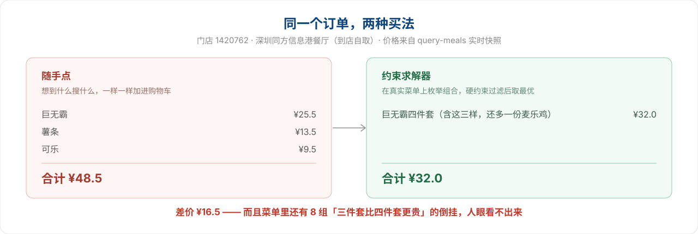
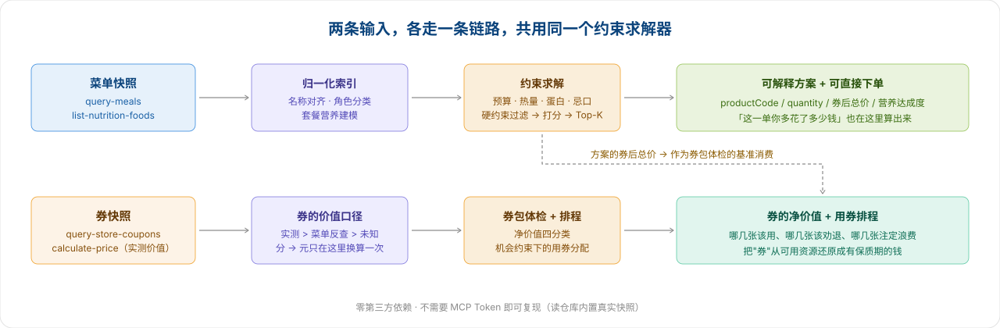

<div align="center">

# 麦麦点餐参谋

**用约束求解器算出一顿饭，而不是让大模型随口推荐。**
**同样一顿麦当劳，你多花了多少钱——这个数字，我们算得出来。**

基于麦当劳中国 MCP 的点餐推荐 Skill：给定预算、人数、热量/蛋白目标与忌口，
在真实门店菜单上枚举组合、施加硬约束，输出多套**可解释、券后算清、可直接下单**的方案。


[30 秒体验](#30-秒体验) · [多花了多少钱](#这一单你多花了多少钱) · [和让大模型推荐的区别](#它和让大模型推荐套餐有什么不同) · [工作原理](#工作原理)

</div>

---

## 30 秒体验

```bash
git clone https://github.com/pandasir/mcd-value && cd mcd-value
python demo.py
```

**零第三方依赖、不需要 MCP Token、不联网。** `demo.py` 读仓库内置的真实门店快照
（2026-10-14 抓取自「麦当劳深圳同方信息港餐厅 1420762」，已脱敏，不含任何个人数据），
一次跑通全部叙事。



---

## 这一单你多花了多少钱

```
① 这一单，你多花了多少钱
   意图：想吃到「巨无霸 + 薯条 + 可乐」

   单点买法      巨无霸 ¥25.5 + 薯条 ¥13.5 + 可乐 ¥9.5 = ¥48.5
   求解器买法    巨无霸四件套 ×1 = ¥32.0（含这三样，还多一份麦乐鸡）
                 ──────────────────────
   你多花了      ¥16.5
```

**同一个订单，两种买法，差 ¥16.5 —— 而且求解器选的那个还多给一份麦乐鸡。**
这不是估算，`¥25.5 / ¥13.5 / ¥9.5 / ¥32.0` 四个数字全部直接来自 `query-meals` 的原始返回。

## 菜单里的坑，肉眼看不见

```
② 菜单里本来就有坑：份数更多，反而更便宜
   全菜单扫出 8 组（直接来自 query-meals 的原始价格）：
     · 培根安格斯厚牛堡：三件套 ¥45.5 > 四件套 ¥37.0　→ 省 ¥8.5
     · 板烧鸡腿堡：三件套 ¥34.5 > 四件套 ¥28.0　→ 省 ¥6.5
     · 不素之霸双层牛堡：三件套 ¥37.5 > 四件套 ¥32.0　→ 省 ¥5.5
     · 芝士安格斯厚牛堡：三件套 ¥42.5 > 四件套 ¥37.0　→ 省 ¥5.5
     · 巨无霸：三件套 ¥36.5 > 四件套 ¥32.0　→ 省 ¥4.5
     · 酥酥多笋卷：三件套 ¥31.5 > 四件套 ¥28.0　→ 省 ¥3.5
     · 培根蔬萃双层牛堡：三件套 ¥35.5 > 四件套 ¥32.0　→ 省 ¥3.5
     · 双层深海鳕鱼堡：三件套 ¥35.0 > 四件套 ¥32.0　→ 省 ¥3.0

   同一份主食，点『三件套』的人多花钱、还少拿一份。
```

这条结论是一次全菜单扫描的结果，**不需要任何人猜**：把同一主食的三件套和四件套价格两两相减即可。
它是这个项目存在的理由的浓缩 —— **推荐常有，账算得清的少。**

---

## 它和「让大模型推荐套餐」有什么不同？

市面上同类项目大多是"把菜单丢给大模型，让它编一套搭配"。这有三个硬伤：
**编出来的商品编码是假的、价格是猜的、营养是按印象说的。**

麦麦点餐参谋把这一步换成了**显式约束求解**：

| | 常见做法 | 本项目 |
|---|---|---|
| 商品来源 | 模型凭印象生成 | `query-meals` 真实返回，编码可直接下单 |
| 价格 | 估价 | 门店实时快照 + 券规则计算，下单前再用 `calculate-price` 复核 |
| 营养 | 凭印象 | 营养库实测值；套餐用显式建模，**并标注置信度** |
| 选品逻辑 | 模型主观偏好 | 预算/热量/蛋白/忌口作为**硬约束**，不满足直接淘汰 |
| 输出 | 一段话 | Top-K 方案 + 营养达成度 + `order_items` 直传下单 |

**一句话**：模型负责理解你的需求，数学负责算方案。

## 券不是「可用资源」，是**有保质期的钱**

`available-coupons` 只给券名，不给面值 —— 而「王牌小食拼」这种券名里连数字都没有。
所以我们先把**每张券值多少钱**算出来，再判断该不该用：

```text
🎟️  券包体检 · 1420762 麦当劳深圳同方信息港餐厅
   基准：你这一单本来要花 ¥45.0 · 数据时点 2026-10-14 17:26

   [顺手可用] 中薯条买一送一
        面值 ¥13.5（实测） · 净赚 ¥13.5 · 还剩 3天
   [顺手可用] 13.9浓浓黑巧
        面值 ¥7.1（实测） · 净赚 ¥7.1 · 还剩 6天
   [顺手可用] 王牌小食拼
        面值 ¥6.1（实测） · 净赚 ¥6.1 · 还剩 3天
   [无法判断] 6 张价值未知：大脆鸡扒堡早餐两件套、火腿扒堡早餐两件套、巧克力味厚松饼猪柳蛋套餐、…

   名义总额 ¥26.7 → 按你的消费水平可实现 ¥26.7
   ⓘ 6 张价值未知 —— 券面推不出来，我们就不猜；领取后可用带券计价实测。

   消费审计：8 笔已完成订单（跨度 212 天）
     客单价 ¥23.6 · 累计 ¥141.9 · 点单 0.26 单/周（≈ 1.1 单/月）
   用券排程（频率来源：订单实测）：窗口 6 天 × 0.26 单/周 → 大概只会点 1 单，最多用掉 1 张券
     第 1 单 → 中薯条买一送一　净赚 ¥13.5（还剩 3 天）
     排不上 → 13.9浓浓黑巧　净价值 ¥7.1（还剩 6 天）
     排不上 → 王牌小食拼　净价值 ¥6.1（还剩 3 天）
   券包可实现 ¥26.7，但机会只够用掉 ¥13.5 —— 剩下 ¥13.2 注定随券过期浪费。

   还没领的券 3 张（领取免费）：
     · 免费脆薯饼　价值未知
     · 人气麦旋风买一送一　价值 ¥15.5（菜单反查）
     · 9.9元中杯冰美式　价值 ¥2.0（菜单反查）
```

三件事值得单独说：

1. **「王牌小食拼」值 ¥6.1，靠菜单反查永远算不出来。** 券名里没有数字，菜单里也没有这个商品。
   只有把券码传给 `calculate-price`、读回 `discount` 才能拿到 ——
   **反查不只是会低估，还会把真实存在的价值报成 0。**
2. **「6 张价值未知」不是解析失败，是数据事实。** 券面推不出来就不猜，
   渲染时也不给它们编一个"剩余天数"。这条被测试与 CI 钉住：
   `face_value is None` **当且仅当** `value_source == "unknown"`。
3. **可实现的券，未必用得上。** 券会过期，而你点单次数有限 ——
   上面这个账户三个月只点了 8 单，6 天内等不到 3 次点单机会，
   于是 ¥26.7 的券包里有 **¥13.2** 是注定要浪费的。

> **消费审计是「实测」而不是「假设」。** 排程的默认频率来自脱敏订单摘要
> （`data/raw/orders_summary_1420762.json`：只含客单价、频率与跨度，不含逐单明细、
> 商品名与下单日期）。仓库里**没有任何一条原始订单**。
> 你也可以换成自己的：`coupon_doctor.py --orders 你的订单摘要.json`；
> 想回到纯假设模式用 `--no-orders`。**注意**：demo 早期版本假设「3 单/周」，
> 比这个账户的真实频率高约 11 倍 —— 假设定错，结论就从「浪费 ¥6.1」翻成「浪费 ¥13.2」。

券还能叠到具体方案上（只有本单真的含券覆盖的商品时才标注）：

```bash
python scripts/coupon_doctor.py --budget 45          # 默认用仓库内置的订单摘要
python scripts/coupon_doctor.py --budget 45 --no-orders          # 回到纯假设频率
python scripts/adviser.py --budget 30 --mode light --top 5 --coupons
#   → 方案 ¥25.4　“我就喜欢”鸡薯双全盒 + 鲜萃咖啡
#     🎟️ 本单可用：中薯条买一送一　再省 ¥13.5（实测，需门店核验）
```

> 三条假设（基准消费怎么定、窗口内还会点几单、用券不改点单次数）全部写在
> [`docs/COUPON_METHOD.md`](docs/COUPON_METHOD.md) 里，不藏在代码里。
> 其中「窗口内还会点几单」现在默认由**订单实测**给出，而不是拍一个数。

## 工作原理



菜单与券两条输入各走一条链路，共用同一个约束求解器：
**方案的券后总价会成为券包体检的基准消费**，所以"这一单该怎么点"和"这些券该怎么用"
是同一个模型的两次提问，而不是两个互不相干的工具。

## 四种点餐模式

| 模式 | 目标 | 结构要求 | 适用 |
|---|---|---|---|
| `value` | 总价最低（满足饱腹底线） | 主食 | 只想吃饱、预算敏感 |
| `balanced` | 蛋白/性价比/热量结构/脂肪钠 加权 | 主食 + 小食 + 饮品 | 日常一餐 |
| `protein` | 蛋白总量与**每元蛋白** | 主食 + 小食 + 饮品 | 健身增肌 |
| `light` | 控热量与脂肪钠，保底蛋白 | 主食 + 饮品 | 减脂、控糖 |

**一个设计取舍**：只有 `value` 模式以压价为主目标。其余模式把钱当作**约束**而不是目标——
否则求解器会退化成"在预算内挑最便宜的那个"，得出"40 元预算推荐一个 15 元汉堡"的荒唐结果。

## 参数

```text
--budget 总预算（元）      --people 人数            --mode value|balanced|protein|light
--top N 返回方案数         --max-kcal 热量上限       --min-protein 蛋白下限
--no-beef / --no-pork / --no-chicken / --no-fish
--no-spicy / --no-caffeine / --no-dairy / --no-fried
--coupons 叠加券价值（在方案上标注本单可用的券）
--json 结构化输出
```

```bash
python scripts/adviser.py --budget 45 --people 1 --mode balanced
python scripts/adviser.py --budget 45 --people 1 --mode balanced --no-beef --no-fried
python scripts/adviser.py --budget 60 --people 2 --mode protein --json
```

券包体检（`coupon_doctor.py`）另有自己的一组参数：

```text
--budget 预算（元）        --baseline 基准消费（元）    --json 结构化输出
--orders 订单摘要路径      --no-orders 忽略订单数据     --orders-per-week 强制频率
--sanitize 原始返回.json   --out / --summary-out       把 order-list 返回洗成可提交的摘要
```

`data/index.json` 已随仓库提交，全新 clone 可直接跑，无需先建索引。
忌口同时支持**精确标签**（`no-beef` = 牛肉类）与**组合过滤**，两者叠加。

## 这个项目可能对你有用，如果……

- 🌱 **你在做 MCP 相关的项目** —— [`MCP_INTEGRATION.md`](MCP_INTEGRATION.md) 记录了官方文档没写、
  但跑通链路必须知道的实测契约（**`query-meals` 用元、`calculate-price` 用分**、
  到店自取禁止传 `beCode`、券的价值只能靠 `calculate-price` 实测……）。
- 🧮 **你在学约束求解 / 组合优化** —— [`scripts/adviser.py`](scripts/adviser.py) 是一个完整的
  「分桶 → 枚举 → 硬约束过滤 → 多目标打分 → 帕累托去重」实现，**零第三方依赖**，可直接读。
- 🎟️ **你想知道手里的券到底值多少钱** —— [`docs/COUPON_METHOD.md`](docs/COUPON_METHOD.md)
  讲清了三件事：券面价值怎么算、名义 ¥26.7 的券包为什么只能用掉 ¥13.5、哪几张该劝退。
- 📉 **你想知道自己多久点一次、一次花多少** —— `coupon_doctor.py` 从脱敏订单摘要派生出
  客单价与点单频率，把"窗口内还会点几单"从假设变成实测。
- 🍔 **你只想少吃点冤枉钱** —— `python demo.py` 跑一遍，看看你的常用搭配贵在哪。
- 💡 **你也在做麦当劳 MCP 的点餐工具** —— 欢迎对比，也欢迎来 issue 讨论"菜单结构倒挂"这个现象。

**如果它帮你少花了一杯可乐的钱，一个 star 就是最好的反馈。** ⭐

## 接入你自己的门店

本项目通过 WorkBuddy 调用麦当劳 MCP 取实时数据：

1. 在 [麦当劳 MCP 开放平台](https://open.mcd.cn/mcp) 用手机号登录 → 控制台 → 激活，复制 MCP Token。
2. 在 WorkBuddy 的【连接器 → 自定义连接器 → 配置 MCP】填入 [`mcp-config.example.json`](mcp-config.example.json)
   的内容，把 `Bearer ${MCD_MCP_TOKEN}` 换成你的 Token（也可参考 [`.env.example`](.env.example)）。
3. 让 Agent 执行 [`SKILL.md`](SKILL.md) 中的流程：`query-nearby-stores` → `query-meals` → `list-nutrition-foods`，
   把返回写入 `data/raw/`，再跑 `python scripts/build_index.py`。
   快照的字段说明与换店方法见 [`data/raw/README.md`](data/raw/README.md)，
   完整的 Token 申请与快照采集步骤见 [`docs/TOKEN_GUIDE.md`](docs/TOKEN_GUIDE.md)。

**Token 只放环境变量，不要提交到仓库。** 仓库内的快照已脱敏。

## 项目结构

```
mcd-value/
├── demo.py                    30 秒演示：零依赖跑通全部场景，同时是端到端回归
├── SKILL.md                   WorkBuddy Skill 定义（Agent 执行流程与红线）
├── scripts/
│   ├── build_index.py         归一化：名称对齐 → 角色分类 → 套餐营养建模
│   ├── adviser.py             核心引擎：约束求解 + 多目标打分 + CLI
│   ├── coupon_doctor.py       券的价值口径 + 券包体检 + 用券排程 + CLI
│   └── style_check.py         零依赖静态检查（行宽 / 返回类型 / docstring / 未使用 import）
├── data/
│   ├── raw/                   真实 MCP 返回快照（已脱敏，见该目录 README）
│   │   ├── meals_1420762.json          query-meals
│   │   ├── nutrition.txt               list-nutrition-foods
│   │   ├── coupons_1420762.json        query-store-coupons + query-my-coupons
│   │   ├── coupon_probe_1420762.json   calculate-price（券价值的实测缓存）
│   │   └── orders_summary_1420762.json order-list（只含派生指标，无逐单明细）
│   └── index.json             生成的索引（已提交，可直接使用）
├── tests/
│   ├── test_adviser.py        13 项：分类 / 求解 / 打分 / 契约
│   └── test_coupon_doctor.py  34 项：券形态 / 价值来源 / 四分类 / 排程 / 消费审计 / 不编造
├── assets/                    README 展示图（banner / 两种买法对比 / 架构 / 社交卡）
├── docs/
│   ├── COUPON_METHOD.md       券的口径与三条假设
│   ├── TOKEN_GUIDE.md         Token 申请 → MCP 配置 → 快照采集
│   ├── SUBMIT_CHECKLIST.md    参赛强制文件与赛程自查
│   ├── pipeline.svg           处理流程图
│   └── demo-output.md         多场景真实输出
├── .github/workflows/tests.yml CI：规范检查 + 4 版本矩阵 + 索引可复现校验 + demo
├── MCP_INTEGRATION.md         使用的 MCP Tool、调用链与工程要点
├── CONTEST_DECLARATION.md     参赛声明（官方原文，未改动）
└── workbuddy.md               WorkBuddy 开发上下文
```

## 测试与 CI

```bash
python -m unittest discover -s tests -v   # 47 项单元测试
python demo.py                            # 端到端：断言关键不变量，失败退出码非 0
```

覆盖的不变量：角色分类正确性、**预算是硬约束**、均衡模式必须构成完整一餐、
忌口过滤生效、热量上限生效、买一送一券正确计价、下单参数结构契约、预算过低时返回空集而非硬凑；
以及券侧：券形态判定、**价值来源优先级（实测 > 菜单反查 > 未知）**、
券包体检四分类（顺手可用 / 努一把 / 纸面富贵 / 无法判断）、
用券排程的机会约束、**没有来源就不给价值**；
以及消费审计：**订单脱敏后不含订单号/门店/时刻**、已取消订单不计入、
0 元单计入频率但不拉低客单价、给了订单就用实测频率且标明来源。

CI 在 Python 3.9 / 3.10 / 3.12 / 3.13 上跑同一套流程，并**校验 `data/index.json` 可复现**
（`build_index.py` 重建结果必须与提交版本逐字节一致，否则 CI 失败）。全流程零 `pip install`。

## 已知局限

- **营养覆盖率为 92%**：营养库按单品给数，套餐类商品由 `resolve_bundle()` 显式建模推算，
  输出中标注为"估算"。剩余无营养数据的条目（调味酱、部分新品）不参与营养打分。
- **券的价值有边界**：券自带商品码与菜单商品并不一一对应，无法确定对齐的券一律标为"价值未知"，
  不猜。券的可用范围与叠加规则以门店和 App 实时结果为准。
- **消费审计是账户级的聚合，不是逐单分析**：仓库内只提交客单价、频率与跨度这几个派生数字，
  逐单明细、商品名与下单日期不进仓库。审计只说明"你多久点一次、一次花多少"，
  不推断口味偏好。
- **价格是快照口径**：演示用数据来自 2026-10-14 的门店快照，实时价格请用 `calculate-price` 复核。
- **不是营养或医疗建议**：数据与结论仅供参考，以麦当劳官方渠道实时信息为准。

## Roadmap

- [x] 券的净价值计算与用券排程（券不是"可用资源"，是**有保质期的钱**）
- [x] 从历史订单推导客单价与点单频率，把用券排程从"拍一个假设"换成"**订单实测**"
- [ ] 多人场景接入「分享装 / 拼盘」的组合优化（当前已支持但打分权重待调）
- [ ] 早餐 / 夜市时段专属菜单与菜单切换
- [ ] 积分商城兑换组合建议（`mall-points-products`）

## 目标用户

- **上班族 / 学生**：预算固定，想在下单前一次算清"怎么点最划算"
- **健身人群**：有蛋白与热量目标，需要可量化的套餐而非感觉
- **有忌口的人**：不想在菜单里人肉筛掉牛肉/辣/咖啡因
- **多人点单的组织者**：需要在总预算内给一群人配餐并直接拿到下单参数

## 免责声明

本项目为「麦当劳程序员创意开发大赛」参赛作品，由参赛者独立开发，**非麦当劳官方产品**。
项目输出仅供参考，不构成医疗、营养或其他专业建议；餐品信息、价格及供应状态以麦当劳官方渠道的实时结果为准。

## License

MIT
